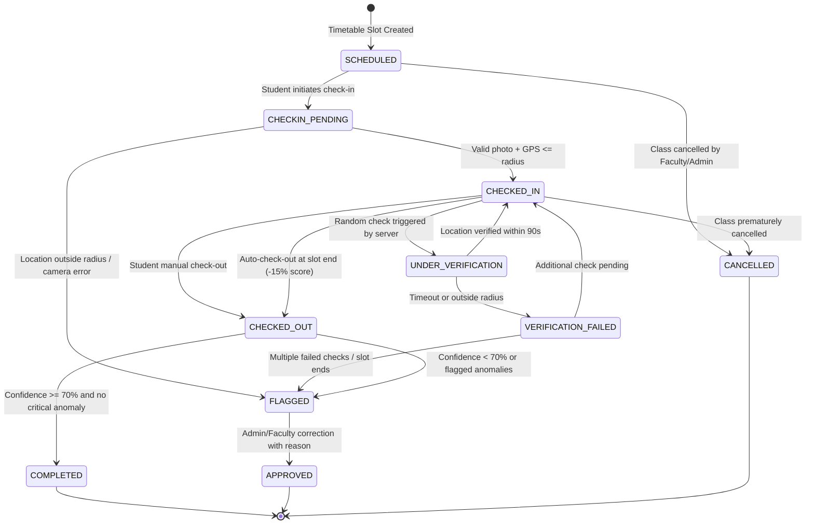

# Product Requirements Document (PRD) — Extremis

---

## 1. Document Overview
- **Project Name:** Extremis *(formerly AttendIQ)*
- **Product Type:** College PBL (Project-Based Learning) Web Application
- **Architecture:** Layered MVC Modular Monolith (Spring Boot 3.4, Java 21 LTS, Thymeleaf, Bootstrap 5, MySQL, Spring Security)
- **Document Version:** 1.0.0
- **Status:** Under Stage 1 Review

---

## 2. Problem Statement & One-Line Definition
### 2.1 Problem Statement
In higher education institutions, traditional attendance methods (paper registers, manual roll calls, and even static QR code scans) suffer from widespread proxy attendance, buddy punching, and lack of real-time presence verification during class hours. Furthermore, students and faculty lack predictive intelligence regarding attendance shortages, discovering defaulter status only when it is too late to remediate before semester examinations.

### 2.2 Product Definition
**Extremis** is a secure student presence and attendance intelligence platform that enforces physical presence during scheduled timetable slots using live camera snapshots and browser geolocation (validated via the Haversine formula against classroom geofences), conducts randomized presence checks during the session, detects suspicious anomalies with rule-based scoring, and delivers actionable attendance intelligence (safe absence buffers, recovery class forecasting, and defaulter risk levels).

---

## 3. User Personas & Role-Based Access Control (RBAC)

The application enforces strict separation of privileges across four distinct roles:

| Role | Key Capabilities | Restrictions |
| :--- | :--- | :--- |
| **Student** | • View timetable for the current day • Live photo + GPS check-in during active class window • Respond to random presence verification prompts • Manual check-out at class conclusion • View own attendance (overall %, subject-wise %, history) • View attendance alerts, safe absence buffer & forecasting | Cannot edit, create, or delete attendance records. Cannot bypass geofence or camera capture. |
| **Faculty** | • View assigned subjects, sections, and timetables • View live session attendance and student presence in real time • View flagged anomalies and confidence scores • View analytical charts and download attendance reports (CSV, PDF, Excel) | Cannot modify or delete attendance records. Cannot alter class timetable. |
| **Class Teacher** | • All Faculty capabilities across the assigned class/section • View comprehensive class defaulters list (<75%) • View students needing proactive academic intervention • Download section-wide composite attendance reports | Cannot modify or delete attendance records. |
| **Management / Admin** | • Master management: Departments, Subjects, Classrooms (lat/lon/radius), Timetable slots, Users, Faculty allocations • Approve student device change requests • Attendance manual corrections (**strictly requires mandatory justification reason**) • View tamper-evident system audit logs | System-wide governance; all corrective actions are immutably logged with user, IP, timestamp, old value, and new value. |

---

## 4. Attendance State Machine

Attendance sessions transition strictly through defined states governed by business validation guards:

### 4.1 State Definitions and Transition Rules
1. **`SCHEDULED`**: The session exists on the timetable for today's date.
2. **`CHECKIN_PENDING`**: Student clicked "Check In"; live camera and GPS acquisition are in progress.
3. **`CHECKED_IN`**: Student submitted valid live photo and GPS within classroom radius during the open check-in window ($[\text{start}-5\text{m}, \text{start}+15\text{m}]$).
4. **`UNDER_VERIFICATION`**: Randomized presence check prompt is presented on the student's active browser page (90-second response window).
5. **`VERIFICATION_FAILED`**: Student failed to respond within 90 seconds or submitted a location outside the geofence.
6. **`CHECKED_OUT`**: Check-out action executed (either manually by student or automatically at slot end).
7. **`COMPLETED`**: Session finalized with Confidence Score $\ge 70\%$ and marked as valid attendance.
8. **`FLAGGED`**: Attendance recorded with anomalies or Confidence Score $< 70\%$ (flagged for review).
9. **`APPROVED`**: Manually rectified by Admin with mandatory reason recorded in Audit Log.
10. **`CANCELLED`**: Class session was officially cancelled.

---

## 5. Mathematical Formulas & Business Rules

### 5.1 Geofence Validation: Haversine Formula
The distance $d$ between the student's GPS coordinate $(\phi_1, \lambda_1)$ and the classroom center $(\phi_2, \lambda_2)$ in meters:

$$\Delta\phi = (\phi_2 - \phi_1) \cdot \frac{\pi}{180}, \quad \Delta\lambda = (\lambda_2 - \lambda_1) \cdot \frac{\pi}{180}$$

$$a = \sin^2\left(\frac{\Delta\phi}{2}\right) + \cos\left(\phi_1 \cdot \frac{\pi}{180}\right) \cdot \cos\left(\phi_2 \cdot \frac{\pi}{180}\right) \cdot \sin^2\left(\frac{\Delta\lambda}{2}\right)$$

$$c = 2 \cdot \text{atan2}\left(\sqrt{a}, \sqrt{1-a}\right)$$

$$d = R \cdot c \quad \text{where } R = 6,371,000 \text{ meters}$$

**Condition:** Distance $d \le \text{Classroom Radius}$ (default: $30$–$50$ meters) and GPS Accuracy $\le 50$ meters.

---

### 5.2 Confidence Score & Rule-Based Anomaly Scoring
Each attendance session begins with a base score of **100%**:

| Anomaly Condition | Confidence Impact | Status Trigger |
| :--- | :--- | :--- |
| Check-in location $> \text{Classroom Radius}$ | $-35\%$ | Immediate `FLAGGED` |
| GPS Accuracy $> 50$ meters | $-15\%$ | Anomaly Note |
| Impossible spatial velocity ($>15$ km/h between presence checks) | $-30\%$ | Immediate `FLAGGED` |
| Missed/Failed randomized presence check | $-25\%$ per check | Anomaly Note |
| Device fingerprint mismatch | $-40\%$ | Immediate `FLAGGED` |
| Check-in delayed past $+15$ minutes of start time | $-10\%$ | Anomaly Note |
| Missed manual check-out (auto-checkout triggered at slot end) | $-15\%$ | Anomaly Note |

- **Final Classification:**
  - $\text{Confidence Score} \ge 70\%$: **`VERIFIED`** $\rightarrow$ `COMPLETED`
  - $\text{Confidence Score} < 70\%$: **`REVIEW_REQUIRED`** $\rightarrow$ `FLAGGED`

---

### 5.3 Attendance Intelligence & Forecasting Formulas

1. **Current Attendance Percentage:**
   $$P = \left(\frac{A}{T}\right) \times 100$$
   *(where $A = \text{Attended Sessions}$, $T = \text{Total Conducted Sessions}$, $P_{\text{min}} = 75\%$ default threshold)*

2. **Safe Absences Buffer (when $P \ge P_{\text{min}}$):**
   $$S = \max\left(0, \left\lfloor \frac{A - (0.75 \times T)}{0.75} \right\rfloor\right)$$
   *Explanation: The number of upcoming classes the student can safely miss while keeping overall attendance at or above 75%.*

3. **Recovery Classes Needed (when $P < P_{\text{min}}$):**
   $$R = \left\lceil \frac{(0.75 \times T) - A}{1 - 0.75} \right\rceil = \left\lceil \frac{0.75 \times T - A}{0.25} \right\rceil$$
   *Explanation: The exact number of consecutive upcoming classes the student must attend to elevate their percentage back to 75%.*

4. **Risk Categorization:**
   - **High Risk:** Current $P < 75\%$ OR consecutive recent absences $\ge 3$.
   - **Medium Risk:** $75\% \le P < 80\%$ (danger zone, close to boundary).
   - **Low Risk:** $P \ge 80\%$ with steady attendance pattern.

---

## 6. Functional Specifications by Module

### Module A: Authentication, Sessions & Device Binding
- Spring Security form login with BCrypt password hashing.
- Single active session per user enforced (`maximumSessions(1)` with `expiredUrl("/login?expired")`).
- Browser fingerprint generated client-side from hardware/browser metrics and sent during login.
- First student login automatically registers device fingerprint. Subsequent logins with a different device are locked until approved in Admin portal.

### Module B: Timetable-Driven Check-In
- Responsive student dashboard displays today's schedule organized chronologically.
- Check-in button is enabled only during the active window ($[\text{start}-5\text{m}, \text{start}+15\text{m}]$).
- Browser captures:
  - Live video frame from front camera via WebRTC `navigator.mediaDevices.getUserMedia` (no file/gallery upload).
  - Geolocation coordinates via `navigator.geolocation.getCurrentPosition` (`highAccuracy: true`).
- Server computes Haversine distance, validates device, stores photo proof in `uploads/proofs/YYYY/MM/DD/`, and initializes session.

### Module C: Randomized Presence Verification
- Server schedules $N=2$ random verification timestamps uniformly distributed inside class time window.
- In-page prompt appears when due; student must tap "Verify Presence" within 90 seconds.
- Re-captures GPS coordinates and confirms student is still within the classroom geofence.
- Automatic fallback: If student closes browser or fails to check out, auto-checkout triggers at slot end with a $-15\%$ confidence deduction and flagged status if checks were missed.

### Module D: Admin Operations & Audit Logging
- Complete CRUD for departments, subjects, classrooms (with coordinates and radius), faculty, students, and timetable slots.
- Attendance Correction Modal: Admin can change an attendance record status from `FLAGGED` to `APPROVED` or adjust records. **Requires a non-empty reason string.**
- Immutable `audit_logs` record created automatically: `record_id`, `old_value`, `new_value`, `changed_by`, `reason`, `ip_address`, `timestamp`.

### Module E: Dashboards & Multi-Format Reporting
- **Student Dashboard:** Today's timetable, overall and subject-wise percentages, safe absence badges, recovery alerts, and recent history.
- **Faculty / Class Teacher Dashboard:** Live class attendance view, presence indicators, anomalies list with one-click detail modal, defaulters list, analytics charts.
- **Report Generator:** Export section/subject attendance summaries to **CSV**, **Microsoft Excel (.xlsx)**, and **PDF**.

### Module F: Privacy & Proof Photo Retention
- Photo proofs are stored strictly as evidence for faculty/admin review. No facial biometric recognition is performed.
- Automated Spring `@Scheduled` background worker runs nightly: purges photo files older than 30 days while preserving all attendance logs and metadata.

---

## 7. Normalized Database Schema (13 Entities)

1. `users` (id, username, password_hash, full_name, email, role, enabled, created_at)
2. `departments` (id, code, name)
3. `sections` (id, name, department_id, semester, academic_year, class_teacher_id)
4. `students` (id, user_id, roll_number, registration_number, section_id)
5. `faculty` (id, user_id, employee_code, department_id, designation)
6. `subjects` (id, code, name, department_id, credits)
7. `classrooms` (id, room_number, building, latitude, longitude, radius_meters)
8. `timetable_slots` (id, subject_id, section_id, faculty_id, classroom_id, day_of_week, start_time, end_time)
9. `attendance_sessions` (id, timetable_slot_id, student_id, session_date, status, confidence_score, checkin_time, checkout_time, checkin_lat, checkin_lon, checkin_photo_path, checkout_type, flag_reason)
10. `attendance_events` (id, session_id, event_type, scheduled_time, prompted_time, responded_time, status, lat, lon, distance_meters, accuracy_meters)
11. `devices` (id, student_id, device_fingerprint, device_name, is_approved, registered_at)
12. `audit_logs` (id, entity_name, entity_id, action, old_value, new_value, changed_by_user_id, ip_address, reason, timestamp)
13. `system_settings` (setting_key, setting_value, description)

---

## 8. Non-Functional Requirements & Security
- **Security:** CSRF protection enabled on all POST requests; BCrypt password encoding (strength 10); Spring Security RBAC.
- **Responsiveness:** Bootstrap 5 mobile-first layout optimized for smartphones (viewport meta tag, responsive touch targets $\ge 48$px).
- **Validation:** Jakarta Bean Validation on all DTOs and forms with user-friendly error banners.
- **Packaging:** Standalone executable `.jar` via `mvn clean package`.

---

## 9. Limitations & Explicit Disclosures
- **Browser-Based Geolocation:** Web browsers rely on the OS/browser Geolocation API. While the system checks accuracy, impossible velocity, and geofence distance, hardware-level mock locations or rooted GPS spoofing cannot be 100% intercepted by any pure web browser application. This is documented transparently in system logs and the project README.
- **Background Tracking:** Browser security prohibits persistent background tracking when the tab is closed. Randomized presence checks therefore require the student to keep the web tab accessible or open during class.

---

## 10. Scope Split: MVP vs. Phase 2

### MVP Scope (Deliverable in Stages 2 – 6)
- Core DB schema, Spring Boot 3.4 setup, Spring Data JPA, seed data.
- Spring Security auth, roles, single session control, student device registration.
- Admin management (departments, rooms, subjects, timetable, users).
- Timetable check-in with camera snapshot + HTML5 GPS + Haversine check.
- Attendance state machine implementation.
- Randomized presence verification prompt & auto-checkout rule.
- Confidence scoring and anomaly classification.

### Phase 2 Scope (Deliverable in Stages 7 – 9)
- Attendance intelligence formulas (defaulter forecasting, safe absence buffer, risk badges).
- Faculty & Class Teacher dashboards with analytics charts.
- Multi-format report export (CSV, Excel, PDF).
- Attendance correction modal with mandatory audit logging.
- Photo proof retention `@Scheduled` cleanup service.
- Comprehensive unit tests (Haversine, Forecasting, State Machine), README, and final `.jar` packaging.
